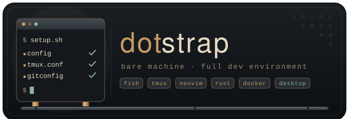

# Dotstrap - From a bare machine to a full development environment

[](https://github.com/TumbleOwlee/dotstrap/actions/workflows/lint.yml)

This repository contains various scripts and configuration that I use in my various environments - private or work, bare metal or virtual machine.
I created this collection since I'm usually working with various virtual machines and I want to have my environment set as fast as possible while providing the same user experience on each of them. Everything is done using only Bash since it's the common base of every Unix install. Of course it would be fancier using e.g. Python's full capabilities.

## Set up Unix Environment

**Supported:** Arch Linux, Ubuntu LTS (22.04+), Debian stable. Running as root (e.g. in containers) works, otherwise `sudo` is required.

**Prerequisites:** `bash`, `tar`, `gzip`, an internet connection and `curl` or `wget` for the download. Everything else is installed by the setup. The command works in every shell:

```bash
curl -fsSL https://raw.githubusercontent.com/TumbleOwlee/dotstrap/main/Unix/setup.sh | bash -s --
# or
wget -qO- https://raw.githubusercontent.com/TumbleOwlee/dotstrap/main/Unix/setup.sh | bash -s --
```

Flags go at the end, e.g. `... | bash -s -- --noconfirm --skip=docker`. From a checkout run `./Unix/setup.sh`, which uses the local files.

`Unix/setup.sh` downloads one tarball of the repository, so a run never mixes files of different commits, and starts `Unix/lib/main.sh`. Set `DOTSTRAP_REF` to install a branch, tag or commit other than `main`, and `DOTSTRAP_REPO` to use a fork.

If you are behind a proxy, set `http_proxy` and `https_proxy`. Offline installation is not supported.

### Flags

| Flag | Effect |
| --- | --- |
| `-n`, `--noconfirm` | Answer every question with its default. Implied if there is no terminal. |
| `-v`, `--verbose` | Print the command output instead of the status line. |
| `--skip=a,b` | Don't install these modules. |
| `--include=a,b` | Install these modules, even if off by default or left out by `--minimal`. |
| `--only=a,b` | Install only these modules and what they depend on. |
| `--minimal` | Smallest result, see [Development image](#development-image). |
| `--dry-run` | Print the plan and exit. Changes nothing. |
| `--list` | List the modules and exit. |
| `--log` | Show the log of the last run and exit. |

### How a run works

1. All questions are asked first: a list to select the modules from (arrow keys or `j`/`k` move, space toggles, `a` toggles all, enter confirms, `q` aborts; what a selected module depends on is added), whether to use the upstream release or the package, and whether to replace an existing non-git `~/.config/nvim`. After that the run is unattended. The list is not shown with `--only`, and modules already settled by `--skip`, `--include` or `--minimal` are not in it.
2. Each module runs in the background. In a terminal a status line with the step, the elapsed time, the command and its last output line updates every second. Without a terminal a plain status line is printed every 10 seconds.
3. The output goes to `~/.local/state/dotstrap/<timestamp>.log`. The last 5 logs are kept, use `--log` to read the latest one. A failure prints the end of the log.
4. If a module fails, a terminal offers retry, log, skip and abort. Without a terminal it is tried once more, then an optional module is recorded and the run continues, a failed `base` ends it. Modules depending on a failed module are left out. The run ends with a summary and exits non-zero if anything is missing.
5. Everything tools build or cache during the run goes to a work directory in `/var/tmp`, removed at the end also on failure and interrupt. This covers temporary files, `XDG_CACHE_HOME` and the cargo registry. Caches you already had stay untouched.

**Upstream or package:** zoxide, rustup, delta, mise and (Debian/Ubuntu) neovim default to the upstream release. In a terminal you are asked if the package manager offers them too; `--noconfirm` uses upstream.

**Neovim plugins:** a plugin that keeps failing to install or is damaged (no commit or missing tracked files), e.g. because a network problem or standby interrupted its clone, is moved to `~/.local/share/nvim/lazy-failed.<timestamp>` and cloned again. The summary lists it. Delete that directory once you know it holds nothing you need.

**Neovim on Debian/Ubuntu:** the neovim configuration requires Neovim 0.12 or newer. The upstream prebuilt release goes to `/opt/nvim` (linked to `/usr/local/bin/nvim`). If the package is older than 0.12, it is not offered. On Arch the package is used.

## Modules

| Module | Installs |
| --- | --- |
| `upgrade` | System upgrade |
| `base` | Required. Git, Python (+ `python3-venv` on Debian), pipx, Unzip, Wget, Less, Curl, GPG, FZF, CA certificates, zoxide |
| `fish` | Fish shell as login shell, prompt/greeting/`colored_cat` functions |
| `tmux` | tmux and its configuration |
| `neovim` | Neovim, ninja, [neovim-config](https://github.com/TumbleOwlee/neovim-config) (plugins and the LSPs `lua-language-server`, `python-lsp-server` via Mason), `tree-sitter-cli` (needs rustup and the stable toolchain) |
| `fonts` | FiraCode Nerd Font |
| `docker` | docker, compose (+ buildx if available), user added to the `docker` group |
| `rust` | rustup with the stable toolchain, `rustfmt`, `clippy`, `rust-src`, `rust-analyzer` |
| `rust-cross` | libclang, `cross` |
| `cxx` | clang, gcc, make, cmake, ninja, lldb, autoconf, automake, libtool, pkg-config (+ `clang-format` on Debian/Ubuntu) |
| `conan` | Conan via pipx |
| `alacritty` | Alacritty and its configuration. Packaged on Arch, built from source on Debian/Ubuntu |
| `delta` | git-delta and its git configuration |
| `mise` | mise |
| `claude` | [Claude Code](https://claude.com/claude-code) via the native installer (`~/.local/bin/claude`, updates itself) |
| `rtk` | [rtk](https://github.com/rtk-ai/rtk) in `~/.local/bin` and its global Claude Code hook (`rtk init -g`) |
| `caveman` | [caveman](https://github.com/JuliusBrussee/caveman) as Claude Code plugin in the user scope. Needs `claude` |
| `scripts` | `git-sync`, `git-check`, `git-hooks`, `dbg`, `finance`, `win-move` in `~/.local/bin` |
| `yay` | Arch only. `base-devel` and `yay` (built from the AUR, as a temporary build user when running as root) |
| `desktop` | Arch only, off by default. See [Desktop Environment](#desktop-environment-bspwm-arch) |

### Adding a module

Add one file to `Unix/modules/`. It is found automatically, the options are documented at `module` in `Unix/lib/main.sh` and the helpers in `Unix/lib/helpers.sh`:

```bash
#!/bin/bash
# tmux and its configuration.

module tmux --desc "tmux" --packages "tmux" --after "fish"

function tmux_install {
    put "Configs/tmux/tmux.conf" "$HOME/.tmux.conf" 644 backup
}
```

`--packages` takes logical names; add a mapping to `pkg_name` if they differ per distribution. An install function runs with `set -e` and without a terminal, so it can't prompt: ask questions in `<name>_prepare`. It must be safe to run again, because a retry starts the module over. Use `run` for commands to show them in the status line. A tool installed into the home directory must be put on PATH: `add_to_path <dir>`, or `add_command_to_path <cmd>` to add its directory only if it isn't a system package. Put temporary files into `$TMPDIR` and don't delete them, the work directory is removed at the end. Never delete by glob in a shared location or anything the setup didn't create: move things to a backup instead.

### Written files and backups

Files managed by the setup are rewritten on every run and must not be edited.

This project used to be called `env-setup`. A run on a machine set up back then moves `~/.config/env-setup` to `~/.config/dotstrap` and the logs to `~/.local/state/dotstrap`, and updates the line in the shell startup files. The modules that run replace their files of the old name. `~/.config/env-setup` stays as a link, because the files of modules that didn't run still use it. Delete it once you have run every module you use. `ENV_SETUP_REF`, `ENV_SETUP_REPO` and `ENV_SETUP_MODULES` are now `DOTSTRAP_REF`, `DOTSTRAP_REPO` and `DOTSTRAP_MODULES`.

| File | Content |
| --- | --- |
| `~/.config/dotstrap/paths` | The directories added to PATH, one per line. A module adds the directory it installs into, e.g. `~/.local/bin` for `scripts` and `claude` or `~/.cargo/bin` for `rust`. Lines are only added, delete one you don't want. |
| `~/.config/dotstrap/bashrc.sh` | Adds the directories of `paths` to PATH and sets up zoxide in interactive bash. Sourced from one line the setup appends to `~/.bashrc`, `~/.profile` and an existing `~/.bash_profile`, so login shells get PATH too. |
| `~/.config/fish/conf.d/dotstrap.fish` | The same for fish, plus the `cat` alias and `vim`/`vi`/`v` abbreviations for nvim. |
| `~/.config/fish/functions/` | `fish_greeting`, `fish_prompt`, `colored_cat`. |
| `~/.config/tmux/dotstrap.local.conf` | Sets fish as tmux `default-shell`. Sourced by `~/.tmux.conf`. |
| `~/.tmux.conf` | Repository configuration. |
| `~/.config/git/dotstrap.gitconfig` | Delta settings, added to the global git config through an `include.path` entry. |
| `~/.config/delta/themes.gitconfig` | Delta themes. |
| `~/.config/alacritty/alacritty.toml` | Repository configuration. An old `alacritty.yml` is renamed. |
| `~/.config/nvim` | Clone of neovim-config, updated with `git pull --ff-only`. |
| `~/.local/share/fonts/FiraCode` | Nerd font. |
| `~/.claude/settings.json`, `~/.claude/CLAUDE.md`, `~/.claude/RTK.md` | Hook and instructions added by `rtk init -g`, which keeps the rest of the files. |

Before an existing file is replaced (`~/.tmux.conf`, `alacritty.toml`, `alacritty.yml`, a non-git `~/.config/nvim`) a copy is saved as `<file>.bak.<YYYYmmddHHMMSS>`. Blocks appended to `~/.bashrc` and `~/.config/fish/config.fish` by older versions of these scripts are removed automatically, after saving a backup of the file in the same way.

## Development image

The `Dockerfile` builds a minimal development image with a non-root user (`dev`, with passwordless `sudo`) on `debian:<version>-slim`:

```bash
docker build --build-arg DEBIAN_VERSION=13 -t dev-env .   # default: stable
docker run --rm -it -v "$PWD":/work -w /work dev-env
```

Further build arguments are `DEV_USER`, `DEV_UID`, `DEV_GID` (default 1000) and `SETUP_FLAGS`, e.g. `--build-arg SETUP_FLAGS=--include=docker,mise`. Set the ids to the ones of your host user (`id -u`, `id -g`) to have access to the files you mount. `~/.local/bin` and `~/.cargo/bin` of the user are in the `PATH` of the image, so the tools are also found by `docker run <image> <cmd>`, which reads no shell startup files.

`./build.sh` asks for these settings in the terminal and builds the image: the Debian version and the modules are chosen from a list (arrow keys or `j`/`k` move, space toggles, `a` toggles all, enter confirms, `q` aborts), the user name, ids (default: yours) and tag are edited in place. The selected modules are passed as `--only=... --include=...`, so their dependencies are added and modules left out by `--minimal` can be selected. Before building, the script shows the `docker build` command and asks for confirmation.

The image uses `setup.sh --minimal`, which also works outside of Docker:

* Leaves out `alacritty`, `caveman`, `claude`, `docker`, `fonts`, `mise`, `rtk`, `rust-cross` and `yay` unless they are given with `--include`.
* Installs no recommended apt packages and only the minimal rust profile with the components of the `rust` module.
* Wipes the system wide package caches (apt lists and archives, or the pacman cache and sync database) and removes the log after a successful run. On a real machine this also removes the packages pacman could roll back to.

Run `sudo apt-get update` in the container before installing further packages.

## Desktop Environment (bspwm, Arch)

The `desktop` module installs the bspwm based desktop (bspwm, sxhkd, polybar, rofi, dunst, picom, ...). It is off by default: select it in the module list or use `--include=desktop`. It's only available on Arch.

It installs the packages in `Unix/Environment/packages.txt` with pacman and the ones in `aur-packages.txt` with `yay` (not as root: the summary lists them instead, as it does if `yay` fails, because AUR packages can break independently of this setup), then copies `.config`, `.screenlayout`, `.backgrounds` and `.gtkrc-2.0` into your home directory, **overwriting existing files of the same name**.

Machine specific settings live in `~/.config/dotstrap/local.conf`. The module creates it from `Unix/Environment/local.conf.example` if it does not exist and never overwrites it. The file is sourced by bash and supports:

| Variable | Purpose |
| --- | --- |
| `BT_DEVICES` | Array of `'Name\|AA:BB:CC:DD:EE:FF'` entries for the rofi bluetooth menu |
| `WIN_MOVE_WIDTH`, `WIN_MOVE_HEIGHT` | Override the screen size detected by `win-move` |
| `MONITOR_PRIMARY` | Primary monitor name (`bspc query -M --names`) |
| `WLAN_IF` | Wireless interface for polybar |
| `BATTERY`, `ADAPTER` | Names under `/sys/class/power_supply` |
| `BACKLIGHT` | Device under `/sys/class/backlight` |

All overrides except `BT_DEVICES` are optional; unset values are auto-detected.

## Development

The workflow `.github/workflows/lint.yml` runs `shfmt -d -i 4` and `shellcheck -x` on all tracked shell scripts (`*.sh`, shell shebangs and `bspwmrc`). Use 4 spaces for indentation.

`Unix/tests/engine.sh` tests the engine with fixture modules; it installs nothing and needs root or passwordless sudo. The workflow `.github/workflows/test.yml` runs it, a real install on Arch and Debian and builds the image with a size limit.

## Set up Windows Environment

Since I'm mainly developing on Unix based operating systems, this repository doesn't contain any script to setup a full environment on a Windows host. Instead it contains scripts to provide helper functions to simplify the interaction with Unix systems.

To get the provided helper functions in your PowerShell environment, install `Windows/Scripts/connect.py` into `%USERPROFILE%\Scripts` and `Windows/Documents/WindowsPowerShell/profile.ps1` into `%USERPROFILE%\Documents\WindowsPowerShell`.

```powershell
mkdir $home\Scripts
mkdir $home\Documents\WindowsPowerShell

# Wrapper to provide `Connect-SSH` in PowerShell for easy SSH connection
curl.exe -fsSL "https://raw.githubusercontent.com/TumbleOwlee/dotstrap/main/Windows/Scripts/connect.py" -o "$home\Scripts\connect.py"

# Install PowerShell profile that provides the aliases for all functions
curl.exe -fsSL "https://raw.githubusercontent.com/TumbleOwlee/dotstrap/main/Windows/Documents/WindowsPowerShell/profile.ps1" -o "$home\Documents\WindowsPowerShell\profile.ps1"

# Disable Bing Search in start menu
Set-ItemProperty "HKCU:\SOFTWARE\Microsoft\Windows\CurrentVersion\Search" BingSearchEnabled 0
```

The repository also contains an Alacritty configuration for Windows in `Windows/AppData/Roaming/alacritty/alacritty.toml` (to be placed in `%APPDATA%\alacritty`).

Additionally it is advised to install the [`FiraCode Nerd Font`](https://github.com/ryanoasis/nerd-fonts/releases/latest/download/FiraCode.zip) if you use Alacritty with the provided configuration. It's also helpful in case you are using the provided `neovim` configuration, since it requires the patched font to display additional icons.

## Using Bash

The provided setup installs `fish` as the default shell. But if you're using other hosts - where you are unable to install/use `fish` - you can get the same shell prompt by adding the following code into your `~/.bashrc`. 

```bash
colorize_exit_code() {
        exit_code="$1"
        local red=$(tput setaf 1)
        local green=$(tput setaf 2)
        local reset=$(tput sgr0)
        if [ "$exit_code" == "0" ] || [ "$exit_code" == "" ]; then
                printf '\001%s\002[0]\001%s\002' "$green" "$reset"
        else
                printf '\001%s\002[%s]\001%s\002' "$red" "$exit_code" "$reset"
        fi
}

# Most likely such an if-else block will already be present in your .bashrc. Just replace it with this.
if [ "$color_prompt" = yes ]; then
    PS1='${debian_chroot:+($debian_chroot)}(\[\033[0;33m\]\h\[\033[m\]|\[\033[0;34m\]\u\[\033[m\]|\[\033[0;33m\]\w\[\033[m\])$(colorize_exit_code $?)> '
else
    PS1='${debian_chroot:+($debian_chroot)}(\h|\u|\w)[$?]> '
fi
```
